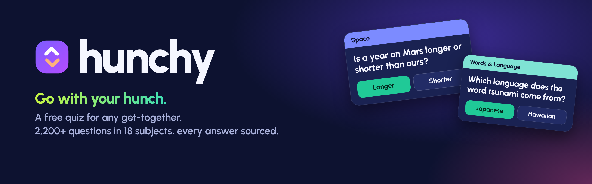

# Hunchy

**A free quiz for any get-together. Go with your hunch.**

**[Play Hunchy](https://shazmoghaddam.github.io/hunchy/)**

Hunchy is a quick guessing game for any get-together: friends round, a party, the pub or a night in. Everyone can play
the same round and have a fair chance: some questions are about Minecraft, Bluey and the Lionesses, some are about the Beatles and the Model T, and
plenty are things anyone might know, like which country is bigger or where IKEA comes from.

It runs in any browser on a phone, tablet, laptop or desktop. No app to install, no account, no adverts.

## How it plays

Every question is one of three kinds, and every round mixes all three:

| Kind | Example |
|---|---|
| **Higher or lower** | The Eiffel Tower is about 330 metres tall. Is the Shard taller or shorter? |
| **Yes or no** | Does a giraffe have the same number of neck bones as a human? |
| **Pick one** | Which country won the 2026 FIFA World Cup? |

After each answer you get a short "did you know" fact and a link to where the answer comes from.

| Way to play | What it is |
|---|---|
| **Today's ten** | Ten questions from ten subjects, the same for everyone that day. Play daily to build a streak, then share your score with your group chat |
| **Quick round** | Ten questions from the subjects you pick |
| **Three lives** | Keep going until you get three wrong |
| **Hunch-off** | 2 to 6 players take turns on one phone. Highest score wins, with a joke break after every round of turns |

**No repeats.** Hunchy remembers every question you've answered in this browser and won't ask one again until
you've seen every question in the subjects you're playing. A mixed round moves through different subjects rather
than doubling up. Today's ten works through the whole bank too, so a question won't come round again for months.

**Your stats** shows your best subjects, longest daily streak, best run at three lives and how many perfect tens
you've scored.

**Settings** on the home screen lets you choose easier questions, switch grown-up jokes and sound on or off, and pick
the dark or light look.

Every result can be shared in one tap. On a phone that opens the share sheet, so it goes straight to WhatsApp,
Messages or anywhere else; on a computer it's copied, ready to paste. Shared scores never give away an answer.

## 200 jokes

Every game ends with a joke, and Hunch-off has a joke break between rounds. You see the setup first, then tap for
the punchline, and any joke can be shared. They come out at random and don't repeat until you've seen them all.

Most of them are for everyone: puns, groan-worthy wordplay and gentle digs. Switch on **Grown-up jokes** in
Settings to add 125 cheekier ones: teasing, a little flirty or a little dark, but never crude. They're off unless someone turns them on.

## 2,200+ questions in 18 subjects

| Subject | Questions | | Subject | Questions |
|---|---:|---|---|---:|
| Music | 270 | | History | 93 |
| Sport | 220 | | Food & Drink | 91 |
| Film & TV | 218 | | Nature & Animals | 85 |
| Art & Culture | 187 | | Cartoons & Animation | 79 |
| Geography | 162 | | Words & Language | 77 |
| Cities & Landmarks | 131 | | Maths | 75 |
| Science | 111 | | Cars & Motorbikes | 75 |
| Leaders & Famous People | 108 | | Space | 70 |
| Inventions & Brands | 100 | | Fashion | 55 |

Sport covers football, the World Cup, the Euros and the Champions League, tennis, the Olympics, the Tour de France,
Formula One and the big events from the Masters to the Boat Race. Music runs from Mozart and Motown to Queen, ABBA,
Oasis and Bad Bunny, with plenty of "who sang it?" and "which of these is a Madonna song?". Film & TV takes in
the big stars and directors, from Casablanca and Top Gun to Barbie and Frankenstein, and Art & Culture visits the great
museums, from the V&A and the Science Museum to the Louvre, MoMA and the Prado. Geography asks capitals both ways round ("Canberra is the capital of which country?") and
follows the Nile, the Amazon, the Equator and both poles, and Cities & Landmarks takes in mountains, rivers and
wonders from Everest and Damavand to the Great Wall, Niagara Falls and the Golden Gate Bridge. Science now includes
chemistry and how the body works, with health facts checked against the NHS. Leaders appear as history, never
as party politics, and there are no questions about religion. Words & Language covers where words come from,
languages of the world, alphabets and wordplay.

Every question is tagged **timeless** (anyone could know it), **classic** (from further back) or **modern** (more
recent), and rated easy, medium or hard. Today's ten always includes at least one classic and one modern question.

## How the answers are checked

A quiz is only fun if the answers are right, so every question carries its source, and the game shows it.

- **Maths** answers are worked out by code, and the tests work them out again a second way.
- **Countries and elements** come from two independent open datasets. A question is only used where both agree:
  capitals, areas and continents from [REST Countries](https://github.com/mledoze/countries) and
  [country-json](https://github.com/samayo/country-json), populations from the
  [World Bank](https://data.worldbank.org/indicator/SP.POP.TOTL), and element symbols from two separate periodic tables.
- **Everything else** was written, then checked against a published source such as an encyclopaedia, NASA, an
  official record or a news report. Facts from after 2025, like the 2026 World Cup, were checked against news
  reports from the time. Where sources disagreed, the question was dropped.
- **Anything that can change**, like a sports record or "the tallest building", says when it was last checked.
- **Questions about who holds a job now**, like the current prime minister, are left out on purpose. They go out
  of date, sometimes within months.
- **Films and songs** were checked a second time against open data: casts and years against
  [a dataset built from Wikipedia](https://github.com/prust/wikipedia-movie-data), and every singer against the full
  [Billboard Hot 100 history](https://github.com/mhollingshead/billboard-hot-100). The tempting wrong answers were
  checked too, so a decoy actor is never secretly in the film. The newest films and songs were also checked
  against news reports.
- **Songs** are asked about by title, artist and year. The game never quotes lyrics.

[questions/CHECKS.md](questions/CHECKS.md) lists the second round of checks and what they changed.

Spotted a mistake? Every answer has a **Report this question** link, or
[open a question check](https://github.com/ShazMoghaddam/hunchy/issues/new?template=question-check.yml).

## Accessibility and privacy

- Works on every screen size, from a small phone to a desktop
- Works offline once it has loaded, and can be added to a phone's home screen like an app
- Large, clear buttons, readable text and strong colour contrast, in a dark look (the default) or a light one
- Sound and a little buzz on phones for each answer, with one switch to turn both off
- Full keyboard support: press 1 to 4 to answer and Enter for the next question
- Screen readers are told whether each answer was right, and the fact that follows
- Respects your device's reduced-motion setting
- No accounts, cookies, adverts or tracking. Scores and streaks are saved only in your browser, and the fonts are
  served from this site rather than a third party

## Run it yourself

Hunchy is plain HTML, CSS and JavaScript with no build step. To run it on a Mac:

```bash
git clone https://github.com/ShazMoghaddam/hunchy.git
cd hunchy
python3 -m http.server 8000
```

Then open http://localhost:8000.

To change or add questions, edit the files in [`questions/`](questions/), then rebuild and test:

```bash
pip3 install -r requirements-dev.txt
python3 questions/build.py   # checks every question and writes data/questions.json
python3 -m pytest
```

[CONTRIBUTING.md](CONTRIBUTING.md) explains how questions are written and checked.

## Project layout

```
index.html               the page, with its icons
assets/app.js            the game
assets/styles.css        the design
sw.js                    keeps a copy of the game for offline play
manifest.webmanifest     lets phones add Hunchy to the home screen
data/questions.json      every question, built by questions/build.py
data/jokes.json          200 jokes, built by jokes/build_jokes.py
questions/curated/       hand-written questions, one file per subject
questions/generated.py   questions worked out from data: maths, countries, elements, planets
questions/datasets/      snapshots of the open datasets those come from
jokes/build_jokes.py     the jokes, in plain Python lists
tests/                   checks every question, answer and joke
```

## Licence

Code, questions and jokes are [MIT licensed](LICENSE). The Urbanist and DM Mono fonts are under the
[SIL Open Font License](assets/fonts/LICENSE.txt), and the dataset snapshots in `questions/datasets/` keep their
[original licences](questions/datasets/README.md).

---

Created by **Shaz Moghaddam** · London
[Website](https://shazmoghaddam.github.io) · [LinkedIn](https://www.linkedin.com/in/shazmoghaddam)
